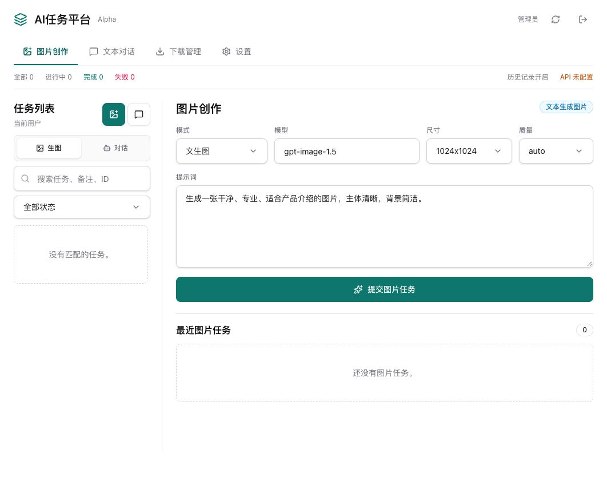

# AI任务平台

**可自托管的 AI 图片创作、参考图编辑与文本对话工作台。**

[English](README.md) · [API 文档](docs/api.md) · [部署说明](docs/deployment.md) · [安全与隐私](SECURITY.md) · [来源声明](NOTICE.md)

> **Alpha 版本。** 使用自行配置、获得授权的模型 API，不提供账号池、网页抓取或个人订阅共享。
> 本次发布完成自动化接口/安全测试和真实浏览器界面检查；因未配置上游凭据，**未进行付费模型的真实生成验收**。
> 没有把测试替身或示例图片冒充真实生成结果。



## 版本与介绍视频

[下载 v0.1.0-alpha.1](https://github.com/eust-w/ai-task-platform/releases/tag/v0.1.0-alpha.1)，
包含横竖版介绍视频、字幕与封面。
在线观看：[B站](https://www.bilibili.com/video/BV1gms96TE8j/) ·
[YouTube](https://www.youtube.com/watch?v=YGa4kcTBZ9s) ·
[抖音](https://www.douyin.com/video/7701826028804508938) ·
[X](https://x.com/eustancewu/status/2115549897919516890)。
详见 [验收范围](docs/launch/validation.md) 与 [各平台发布状态](docs/launch/publication.md)。

## 可以做什么

- 文生图、图生图与多参考图上传，最多 8 张。
- 文本对话与任务记录，统一查看当前 Key 下的工作。
- 查询、搜索、修改标题和备注、删除任务、下载生成文件。
- 创建、修改、停用和删除用户 Key，设置日额度、并发数、请求间隔。
- 选择是否展示和保存新任务的历史内容；浏览器不持久保存登录 Key。
- 独立部署前后端，不依赖原项目的生产账号、服务器或域名。

## 本地启动

需要 Python 3.12+、uv、Node.js 22+，支持 macOS / Linux：

```sh
git clone https://github.com/eust-w/ai-task-platform.git
cd ai-task-platform
uv sync --dev
uv run python scripts/bootstrap.py
npm --prefix web ci
npm --prefix web run build
uv run uvicorn platform_api.app:create_app --factory --host 127.0.0.1 --port 3310 --no-access-log
```

打开 `http://127.0.0.1:3310/api-console/`。启动准备脚本会生成本地 `.env` 和随机管理员 Key。
用其中的 `ATP_ADMIN_KEY` 登录，在设置页创建普通用户 Key。新用户 Key 只返回一次。

没有配置 `OPENAI_API_KEY` 时，仍可以登录、管理 Key、调整历史设置；生成接口会明确返回 503，不会伪造成功。
实际生成需要在 `.env` 中填写获得授权的服务商 Key，并选择账号有权使用的模型，然后重启服务。
平台 Key 与服务商 Key 是两种不同凭据；服务商 Key 不会发送到浏览器。上游调用可能产生费用。

## Docker

准备好 `.env` 后运行：

```sh
docker compose up --build -d
docker compose logs -f
```

默认只监听宿主机 `127.0.0.1:3310`。公网访问请配置 HTTPS 反向代理，禁止直接公开数据目录。
更多方式见 [部署说明](docs/deployment.md)。

## 默认限制与数据保留

新用户 Key 默认每日 50 次、并发 1、每 10 秒最多提交一次。只计算被接受的生成/对话请求，查询与下载不消耗次数；失败的上游尝试仍计算次数。每日额度按 UTC 重置。

历史开启时默认保留任务及文件 7 天。关闭历史会隐藏历史列表，新任务不持久保存提示词、标题、备注和对话正文，但仍保留最多 1 小时的运行元数据、配额记录和生成文件，以便当前任务查询下载。关闭开关不会清除之前保存的历史。详见 [安全说明](SECURITY.md)。

## 现阶段边界

单进程 SQLite 与有界线程池，不是分布式任务系统；服务重启后未完成任务标为中断，不自动重试扣费调用。
当前支持非流式纯文本对话、单次一张图片、配置中的模型。暂不包含工具执行、Responses API、PPT/PSD、Codex CLI 共享网关或 S3/SFTP 直传。

测试中的模型替身仅存在于测试代码。介绍视频使用真实界面截图和合成配音，说明未配置上游，不展示虚构的生成结果。

## 开源来源

沿用 MIT 许可并保留原作者 `Copyright (c) 2026 kunkun`。用户控制台衍生自
[basketikun/chatgpt2api](https://github.com/basketikun/chatgpt2api)，新增独立的授权 API 接入与安全边界。
来源及上游说明差异见 [NOTICE.md](NOTICE.md)。这不是 OpenAI 官方产品；代码许可不代替服务商授权。

欢迎通过 Issue 和 PR 贡献测试、可访问性、服务商兼容性与部署体验。贡献前请阅读 [CONTRIBUTING.md](CONTRIBUTING.md)。
